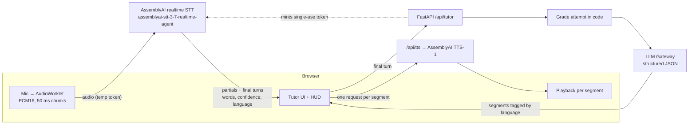

# Lumi: a voice tutor for language learners, built on AssemblyAI

A reference voice agent for the take-home scenario: a customer builds a voice agent for language learners and is evaluating a switch to AssemblyAI. The repo has three parts:

1. **The tutor.** Ask how to say something, then say it back and get word-level feedback. It runs entirely on AssemblyAI: realtime STT, LLM Gateway and TTS, all on one API key.
2. **An evaluation harness.** This is how I'd run, and win, the customer's technical evaluation. The plan behind it is in [`EVALUATION.md`](EVALUATION.md).
3. **Extra credit.** A 60-second pitch coach, built for a YC-batch demo.

```
You:  "How do you say 'where is the library' in Spanish?"
Lumi: "In Spanish you'd say… ¿Dónde está la biblioteca? Now you try."      ← English in the configured voice, Spanish in its own
You:  "Dónde está la… librería?"
Lumi: "Close! Biblioteca, not librería — that's a bookshop. ¿Dónde está la biblioteca?"
       [dónde ✓] [está ✓] [la ✓] [biblioteca ✗]
```

## Quick start

Requirements: Python 3.11+, Chrome or Edge, an [AssemblyAI API key](https://www.assemblyai.com/dashboard), and headphones (recommended).

```bash
python -m venv .venv
source .venv/bin/activate          # Windows: .venv\Scripts\activate
pip install -r requirements.txt
cp .env.example .env               # Windows: copy .env.example .env  -> then paste your key
uvicorn app.main:app --reload
```

Open <http://localhost:8000>, pick *English → Spanish*, press **Start**, and allow the mic. Press **Space** when you've finished a sentence if you don't want to wait out the silence.

On startup the server finds the first LLM in its chain that your key can call and logs it, e.g. `LLM Gateway: answering with gemini-2.5-flash-lite (strict JSON schema)`. `GET /api/health` shows the whole chain.

**Free keys:** LLM Gateway is a paid feature. A free key could call only 2 of the Gateway's 65 models when I tested (`gemma-4-31b` and `qwen3.5-4b-32k-fast`), so on a free key the tutor runs on `gemma-4-31b` and answers about twice as slowly. Add a card in the AssemblyAI dashboard to unlock the default model.

## Architecture



| Path | What |
|---|---|
| `app/main.py` | Routes: `/api/session` (token + STT recipe), `/api/tutor`, `/api/tts`, `/api/roast` |
| `app/grading.py` | Deterministic, word-aligned grading of practice attempts |
| `app/tutor.py` | Prompt, JSON schema for replies, sanitising |
| `app/llm.py` / `app/tts.py` | LLM Gateway and TTS-1 clients, with fallbacks |
| `web/js/stt.js` | Browser client for the v3 realtime WebSocket |
| `web/js/app.js` | Tutor orchestration: turn handling, practice state, barge-in, HUD |
| `evals/` | Streaming eval harness, metrics and configs |

## Key decisions

**1. Everything on AssemblyAI, as a composable stack rather than the managed Voice Agent API.**
The Voice Agent API is the fastest route to a general conversational agent, and the like-for-like swap if the incumbent is an all-in-one speech-to-speech provider. Pronunciation practice needs things a managed loop hides:
- word-level confidence and timing
- turn detection that changes with the conversation state
- explicit control of TTS language per sentence fragment
- grading I can test

Streaming STT, LLM Gateway and TTS-1 give me all of that on one API key. Which of the two products the customer should run is a discovery question (see `EVALUATION.md`).

**2. STT-3.7-Realtime-Agent, steered to the two languages in play.**
The model code-switches natively across 32 languages, so "What's the difference between *ser* and *estar*?" works without configuration. After `Begin`, I send `language_codes: [native, target]` because a learner's imperfect Spanish can otherwise come back as Portuguese or Italian. The app also checks the model name echoed in `Begin`, because unknown connection parameters are ignored rather than rejected.

**3. Turn detection follows the conversation state.**
Learners hesitate, and they hesitate most while attempting a foreign phrase. Conversation turns use `min/max_turn_silence` of 160/1600 ms. Practice turns switch to 560/2400 ms through `UpdateConfiguration`. **Space** sends `ForceEndpoint`, so nobody has to wait out the silence. These numbers are starting points. `evals/` sweeps them on real audio and plots cut-offs against latency.

**4. Context helps, but boosting can hide mistakes.**
After every reply, Lumi's own words are sent as `agent_context`, which helps the STT transcribe the learner's answer. Boosting the practice phrase with `keyterms_prompt` is **off by default**. It cuts false "try again"s on accented but correct attempts, but it can also make the model "hear" *biblioteca* when the learner said *librería*. That trade-off is measured, not guessed: the harness reports the grader's false-accept rate with boosting on and off.

**5. Grade in code; the LLM only coaches.**
LLMs are unreliable judges of "did they say it right?" and a wrong "well done" is the worst thing a tutor can do. `grading.py` aligns the attempt to the target word by word. It ignores accents and word-boundary differences, flags low-confidence words as *unclear*, and hands the LLM a factual summary such as `biblioteca=MISSED (heard "librería")`. To be clear about the limits: this measures **intelligibility** (did a strong speech model understand the attempt?), not phonetics. Stress and phoneme scoring would need a dedicated pronunciation-assessment model, which is on the next-steps list.

**6. Language detection tells an attempt from a question.**
If the learner was asked to repeat a Spanish phrase and replies confidently in English ("wait, what does biblioteca mean?"), that turn is a question, not a failed attempt. The tutor answers it instead of saying "try again".

**7. Each language is spoken by a voice recorded in that language.**
TTS-1 needs the language on every request and doesn't detect it. Replies come back from the LLM as segments tagged by language. English uses the `TTS_VOICE_ID` voice. Every other language uses AssemblyAI's voice recorded in that language (French: `aai-donatien`). Segments are fetched in parallel and played in order. Replays are cached, which matters because TTS bills per character. For a target language TTS-1 doesn't speak yet, that segment falls back to the browser's voice. STT covers 32 languages and TTS covers 6, and that gap belongs in the evaluation.

**8. Latency and security.**
The server mints single-use temporary tokens, so the API key never reaches the browser. Audio goes straight from the browser to AssemblyAI with no relay hop. Setting `ASSEMBLYAI_REGION=eu` keeps STT, LLM and TTS traffic in the EU. The server is stateless: history travels with each request.

**9. Half-duplex by default, barge-in as an option.**
On laptop speakers, an agent that hears itself interrupts itself. While Lumi speaks, the mic stream sends silence, which keeps the audio timeline continuous for the latency maths. With headphones you can enable interruptions: speech, signalled by `SpeechStarted` or a partial, stops playback. In production I'd use a WebRTC transport with proper echo cancellation (LiveKit or Pipecat both have AssemblyAI integrations).

**10. LLM choice: correctness over raw speed, and a chain rather than a single model.**
The default is `gemini-2.5-flash-lite`. The Gateway's own benchmark for short transcripts puts it at 0.70 s p50 and 1.07 s p95. It supports strict JSON schemas, runs in the US and EU, and is the cheapest option. Replies use `response_format` plus the Gateway's `json-repair` step.

The fastest small models are tempting, but teaching a wrong phrase is this product's worst failure. On a free key I measured `qwen3.5-4b-32k-fast` at about 0.5 s per turn. It also taught *"Le gustaría un café"* for "I would like a coffee", which actually means "would *you* like a coffee". So it sits last in the chain:

| Order | Model | Why it's there |
|---|---|---|
| 1 | `gemini-2.5-flash-lite` | Fast, strict schema, US + EU, cheap |
| 2 | `qwen3-32B` | Different provider family, 0.51 s p50, strict schema, US + EU |
| 3 | `gemma-4-31b` | Works on free keys, strict schema, good answers; US only, slow tail |
| 4 | `qwen3.5-4b-32k-fast` | Works on free keys, last resort; prompt-only JSON |

How the chain behaves:
- **Startup.** The server reads the public models catalog to learn which models need prompt-only JSON and which aren't served from the EU. It then spends a few tokens finding the first model the key can call.
- **No access.** A model that answers "no access" is skipped for 10 minutes, so no learner turn pays for discovering it. The 10-minute expiry means a plan upgrade is picked up without a restart.
- **Prompt-only models.** They get the schema written into the system prompt, and every reply is checked for missing keys.
- **Practice state.** The practice loop is owned by code, not the model. A failed attempt never ends practice. A correct one always does. A phrase the model taught but forgot to tag is picked up from its target-language segment.

[Voice Standard Bench](https://www.assemblyai.com/voice-standard/tasks) is how I'd build the shortlist for the customer.

**Measured latency** (23 Nov 2026, US endpoints, a free key, so the LLM is `gemma-4-31b`):

| Stage | Measured | Notes |
|---|---|---|
| Streaming token (`/v3/token`) | ~470 ms | Once per session, before the mic opens |
| LLM turn, `gemma-4-31b` | 1.3–2.1 s, median ≈ 1.5 s | Strict JSON schema |
| LLM turn, `gemini-2.5-flash-lite` | 0.70 s p50 / 1.07 s p95 | The Gateway's published benchmark; needs a paid key |
| TTS-1 time to first audio | 140–330 ms | From the `Server-Timing` header |
| TTS-1 short phrase, whole WAV | 270–790 ms | Cache hit about 2 ms |
| STT end of turn | Shown live in the HUD | `evals/` measures it properly on recorded audio |

The LLM is the long pole. On a paid key the expected reply time is about 1.2–1.5 s from the end of speech to Lumi's voice, against roughly 2–2.5 s on a free key.

## Evaluation harness

`evals/run_eval.py` streams WAV files to a provider **in real time** (50 ms chunks plus trailing silence, exactly like a mic) and scores the results:

| Metric | Why it matters here |
|---|---|
| Target-span accuracy (accent-insensitive and accent-sensitive) | Did *me gustaría* come through? Plain WER hides this behind easy English words |
| WER, overall and on code-switched utterances | Secondary metric; the same normaliser on both sides |
| Premature cut-off rate, overall and on hesitations | The most visible failure for learners |
| End of speech → final transcript, p50/p90 | The price of patience; measured on the audio timeline |
| EOT accuracy, TP/(TP+FP+FN) | AssemblyAI's own end-of-turn metric |
| Language-ID accuracy | Needed to tell attempts from questions |
| Grader false-accept / false-reject | Does the tutor praise mistakes, or reject correct attempts? |

Every metric comes with a 95% bootstrap confidence interval over utterances. Speech end comes from a vendor-independent energy detector, or from a manual annotation, never from a provider's own timestamps.

**Record a smoke-test set (10 minutes).** Open <http://localhost:8000/record.html> and read 16 prompts. They cover questions, code-switching, hesitations, correct attempts, and deliberate mistakes. Move the WAVs to `evals/data/audio/` and `manifest.jsonl` to `evals/data/`. Then listen back and fix any `reference` that doesn't match what you actually said. There's a French set too: open `/record.html?lang=fr`, and use `evals/configs/learner-fr.json` in place of `learner.json` in the commands below.

```bash
# out-of-the-box vs tuned for learners
python -m evals.run_eval --manifest evals/data/manifest.jsonl \
  --config evals/configs/default.json --config evals/configs/learner.json

# find the operating point: cut-offs vs latency
python -m evals.run_eval --manifest evals/data/manifest.jsonl \
  --config evals/configs/learner.json --sweep practice.max_turn_silence=1600,2400,3200

# does boosting the target phrase make the tutor praise mistakes?
python -m evals.run_eval --manifest evals/data/manifest.jsonl \
  --config evals/configs/learner.json --sweep boost_target_keyterms=false,true
```

Each run writes `evals/results/<timestamp>/report.md` and `items.csv`. To compare against the incumbent, implement `IncumbentProvider` in `evals/providers.py`: same interface, same audio and pacing, the incumbent's own recommended settings.

## Extra credit: 60-second pitch coach

<http://localhost:8000/pitch.html> is for a YC batch, where every founder is rehearsing a pitch.
- Live captions come from `assemblyai-stt-3-7-realtime`, the captions model, which is the right one for a monologue.
- Delivery stats (pace, hedge words, long pauses) are computed from word timestamps.
- LLM Gateway gives YC-partner-style feedback.
- TTS-1 reads out the verdict.

That's the same three building blocks and the same API key, put together in about an hour.

## Tests

```bash
python -m pytest
```

There are 55 tests covering:
- grading;
- metrics, with WER cross-checked against `jiwer`;
- API routes, with AssemblyAI mocked at the HTTP layer;
- the LLM chain: no-access skipping, the startup probe, prompt-only JSON, EU routing, and the practice-state rules. The streaming client and the full eval CLI run against a local fake of the v3 WebSocket protocol (`tests/fake_assemblyai.py`), including a sweep showing that impatient turn detection cuts off a hesitating learner.

`tests/test_browser_e2e.py` drives real Chrome with a fake microphone: AudioWorklet capture, token-authenticated streaming, turn handling, practice mode, TTS playback and grading. It needs `pip install playwright` and a local Chrome, and skips itself otherwise.

## Limitations and next steps

- **Intelligibility, not pronunciation.** Add a pronunciation-assessment model for phoneme and stress feedback, and calibrate the "unclear" confidence threshold on labelled attempts.
- **Speech during "Thinking…" is ignored.** Production would queue it or cancel and restart the LLM call.
- **Not production-hardened.** There's no auth or rate limiting on the API, and the TTS cache is in memory.
- **In-stream LLM.** The realtime API can call LLM Gateway per finalized turn (`llm_gateway` parameter), which saves a hop. I didn't use it, because the tutor needs per-turn state and grading on my server. For simpler agents it's a free latency win.
- **TTS covers 6 languages.** If the customer teaches Japanese, plan for that in the evaluation.

## Field notes: friction I hit while building

Feedback I'd pass to the product team, the same as I would from a customer evaluation:

- **Free keys and LLM Gateway.** A free key gets "Your account does not have access to this LLM Gateway model" for 63 of 65 models, with no hint about which models it *can* call. Two cheap fixes at the moment a developer is deciding whether to upgrade: list the usable models in the error or link to the upgrade page, or flag them in `/v1/models`.
- **Silently ignored streaming parameters.** The streaming API ignores connection parameters it doesn't recognise, so a typo in `speech_model` quietly gives you a different model. The client checks `Begin.configuration` to catch this. A warning field in `Begin` would save customers the same debugging.
- **Language on every TTS request.** TTS-1 needs the language on each request, so any bilingual agent ends up writing the per-language segmenting in decision 7. A mixed-language input mode would remove a lot of glue code for language-learning, travel and support use cases.

## How I built this

I built this with AI coding assistants, as the brief encourages. The design decisions and trade-offs above are mine.
